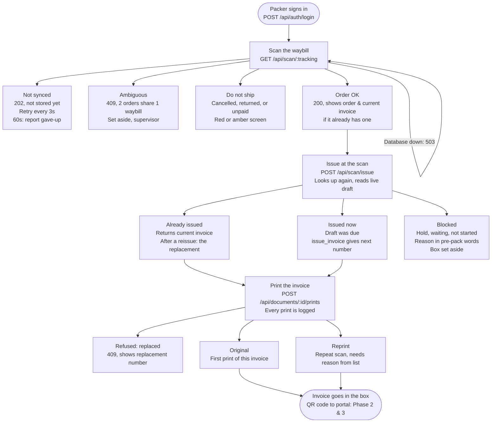

# E-Invoicing App: How It Works

**Document Date:** October 28, 2026  
**Author:** @IT  
**Organization:** Ipolymer Solutions Corp. (`https://einvoice.ipolymersolutionscorp.com`)  
**Compliance Context:** Philippine Bureau of Internal Revenue (BIR) RMC 98-2026, EIS / PTI Compliance

---

## Table of Contents
1. [Overview](#1-overview)
2. [Roles & Permissions](#2-roles--permissions)
3. [System Layout & Architecture](#3-system-layout--architecture)
4. [Packing Scan Workflow](#4-packing-scan-workflow)
5. [After the Invoice: Credit Notes & Reissues](#5-after-the-invoice-credit-notes--reissues)
6. [Problem Paths & Exception Handling](#6-problem-paths--exception-handling)
7. [API Reference](#7-api-reference)
8. [Project Phases & Roadmap](#8-project-phases--roadmap)
9. [Open Decisions for the Accountant](#9-open-decisions-for-the-accountant)

---

## 1. Overview

The app issues a BIR-compliant e-invoice for every marketplace order at the packing scan, and keeps every issued invoice unchanged forever. **BIR RMC 98-2026** requires e-invoices from **31 Dec 2026**; the PTI application is planned for about **26 Nov 2026**, so the app must work well before December.

* **Who sells:** Qualisafe, First Protect, and Baby Bright — 9 stores across Shopee, Lazada, and TikTok Shop, operated by one company.
* **When an invoice is made:** The packer scans the waybill; the database assigns the number; the invoice is printed and goes in the box. A repeat scan is a reprint, never a second invoice.
* **Legal rule:** An issued invoice is never changed or deleted. 
  * A decrease is a **credit note**.
  * A buyer requesting their own registered name means **cancel and reissue** (credit note + new invoice).
* **Today in production:** All stores start invoicing on **31 Dec 2026**, so every order is currently marked as `before_start` and nothing can be issued yet. That is expected.

---

## 2. Roles & Permissions

Access is checked strictly by **named permission**, not by role name. A user can hold several roles simultaneously.

| Role | Main Jobs in the App |
| :--- | :--- |
| **Order Manager** | Packing scan, print and reprint, missed-scan issue, unresolved scans, stations |
| **Accounting** | Credit notes, BIR JSON preview, reissue review (Phase 3), audit log |
| **Executive** | View documents, pre-pack list, credit work list, reports, audit log |
| **IT** | Everything, including users and roles in Django admin |

---

## 3. System Layout & Architecture

One database, `einvoicing`, holds the orders, the write-once ledger, and Django's own tables; the application is the only component staff use to access it.

```mermaid
graph TD
    subgraph Marketplaces
        M[Shopee, Lazada, TikTok<br/>9 stores push orders]
    end

    subgraph BIO-SERVER
        N8N[n8n on BIO-SERVER<br/>Saves orders within seconds]
        DJANGO[Django App (Docker)<br/>Port 8002, user: invoicing_writer<br/>Never reads link tables]
    end

    subgraph LN-DB [LN-DB 10.10.1.21]
        subgraph einvoicing_db [Database: einvoicing (PostgreSQL 18)]
            EINV[einvoice<br/>Orders from n8n<br/>login: n8n_writer]
            INV[invoicing<br/>Write-once ledger<br/>drafts, issue functions]
            APP[invoicing_app<br/>Django's own tables<br/>users, audit log]
            LINK[Link tables<br/>core.orders, stores<br/>from marketing_db]
        end
    end

    subgraph Network & Access
        CADDY[Caddy on OPNsense<br/>https://einvoice.ipolymersolutionscorp.com<br/>Forwards to 10.10.1.20:8002]
        STAFF[Staff Browsers<br/>Order managers, accounting, IT, executives<br/>Personal accounts, 12-hour sessions]
    end

    M --> N8N
    N8N --> EINV
    EINV -.-> INV
    DJANGO --> einvoicing_db
    CADDY --> DJANGO
    STAFF --> CADDY
```

### Architectural Notes
* **Traffic Flow:** Orders flow down from the platforms; staff requests flow up through Caddy to the app.
* **Link Tables:** Link tables are read-only windows into `marketing_db` used only by the database's internal views. If `marketing_db` is unreachable, only the credit-note work list is affected (`503 Service Unavailable`).

---

## 4. Packing Scan Workflow

A scan consists of two sequential calls: a **lookup** (which can never issue anything), followed by an **issue call**. Printing is a third, separate call so every physical print is logged in the audit ledger.



### Operational Rules for Scans
* **Safe Retries:** Lookups can be retried safely every 3 seconds.
* **Idempotency:** Issuing is strictly idempotent. A second scan of the same waybill returns the existing invoice (or the replacement invoice if it was reissued) and prints it as a **reprint with a logged reason**.

---

## 5. After the Invoice: Credit Notes & Reissues

> **Core Legal Rule:** An issued invoice is **never edited**. A cancellation or return receives a credit note, and a buyer requiring their company/personal details receives a cancel-and-reissue.

```mermaid
flowchart TD
    subgraph CreditNoteFlow [Credit Note Workflow]
        CN1[Order cancelled or returned<br/>after invoice was issued<br/>Platform status changes] --> CN2[Accounting work list<br/>GET /api/credit-notes/candidates<br/>Suggested code, lines, and reason]
        CN2 --> CN3[Check what is still open<br/>GET /api/invoices/:id/balance<br/>Never credits more than is open]
        CN3 --> CN4[Credit note issued<br/>POST /api/credit-notes<br/>Full or partial, needs a reason]
    end

    subgraph ReissueFlow [Reissue in Buyer's Name]
        RI1[Buyer wants their own name<br/>Name, address, TIN, branch code<br/>QR portal form: Phase 3] --> RI2[Accounting reviews request<br/>Approve or reject, audited<br/>Review screen: Phase 3]
        RI2 --> RI3[Cancel and reissue<br/>invoicing.reissue_invoice<br/>Credit note + new invoice, single step]
        RI3 --> RI4[New invoice is current<br/>Old one: print refused 409<br/>Scan, draft, & search show new]
    end
```



### Reissue Constraints
* **Reissue Rejections:** A reissue is refused if:
  1. The invoice is already replaced (the user must reissue the replacement instead).
  2. The invoice already has credit notes attached.
  3. The order is now cancelled or returned.
* **TIN & Address Requirements:** A TIN always requires a physical address. For individuals, a name alone is sufficient.
* **Correction Codes:** Reissue credit notes default to code `01` and are dated today until the accountant specifies otherwise.

---

## 6. Problem Paths & Exception Handling

Four issues can arise during the packing scan. Each problem has an explicit mechanism or screen to catch and resolve it:

| Problem at Packing | Root Cause / Event | System Reaction & Recovery Step |
| :--- | :--- | :--- |
| **Draft is blocked** | Waybill printed, but cannot invoice (hold, waiting, or not started) | **Pre-pack exceptions list** (`GET /api/prepack?problems_only=1`, `GET /api/orders/…/draft`). Fixed before the packer reaches the parcel. |
| **Parcel left, no invoice** | Carrier picked up order without scan (Discord alert: Phase 4) | **Order Manager manual issue** (`POST /api/orders/…/issue`). No physical scan needed; buyer receives invoice electronically. |
| **Scan gave up or failed** | 60-second timeout or scanner error kept in log | **Unresolved-scan list** (`GET /api/scans/unresolved`, `POST /api/scans/:id/resolve`). Resolved with an audited note. |
| **System down** | App or database offline, packing must continue | **Manual booklet invoice** written by hand at the packing station. IT enters details in `invoicing.manual_invoices`; subsequent e-invoice references this booklet number. |

---

## 7. API Reference

All endpoints listed below are live in the backend. Access is enforced per **named permission**, and every issue, credit note, and print operation (including refused requests) records an immutable audit entry.

* **Path Conventions:** `…` represents `{platform}/{store_id}/{order_id}`.
* **Data Conventions:** Monetary values are serialized as formatted strings (e.g., `"840.00"`). Timestamps follow **ISO-8601 in Manila Time (UTC+8)**.

| Endpoint | Required Permission | Description & Behavior |
| :--- | :--- | :--- |
| `GET /api/health` | `anyone` | Returns `200 OK` if the database responds; otherwise returns `503`. |
| `GET /api/auth/csrf` | `anyone` | Sets the CSRF token cookie; must be invoked first. |
| `POST /api/auth/login` | `anyone` | Signs in user. `400` on wrong password; `429 Too Many Requests` after 5 failures in 15 mins. |
| `POST /api/auth/logout` | `anyone` | Terminates session and signs out. |
| `GET /api/me` | `signed in` | Returns current username, roles, named permissions, assigned stations, and reprint reason options. |
| `GET /api/scan/{tracking}` | `scan_and_print` | **Lookup only.** `202` if not yet synced, `200` with order details (+ current invoice if present), `409` if ambiguous, `503` to retry. |
| `POST /api/scan/issue` | `scan_and_print` | Issues or returns the current invoice, or explains block reason. Never prints. |
| `POST /api/documents/{id}/prints` | `scan_and_print` | Logs a physical print event. Reprints require a reason code. Replaced invoices return `409`. |
| `POST /api/scans/gave-up` | `scan_and_print` | Records an event where a scan waited longer than 60 seconds. |
| `GET /api/documents/{id}` | `view_documents` | Retrieves document header, line items, print history, credit notes, and `replaced_by` / `replaces` relations. |
| `GET /api/documents?q=` | `view_documents` | Global search by document number, order ID, or tracking waybill number. |
| `GET /api/orders/…/draft` | `view_prepack` | Retrieves live draft: validation state, hold reason, itemized totals, line items, current invoice. |
| `GET /api/prepack` | `view_prepack` | Pre-pack work list. Append `?problems_only=1` to filter exceptions only. |
| `POST /api/orders/…/issue` | `issue_missed_scan` | Issues an electronic invoice for a missed scan without requiring a physical waybill scan. |
| `GET /api/scans/unresolved` | `resolve_scans` | Lists gave-up scans and error scans not yet marked as resolved. |
| `POST /api/scans/{id}/resolve` | `resolve_scans` | Marks an unresolved scan as resolved, accompanied by a mandatory audit note. |
| `GET /api/credit-notes/candidates` | `view_credit_worklist` | Work list of candidate orders needing credit notes with recommended reason codes. |
| `GET /api/invoices/{id}/balance` | `view_credit_worklist` | Returns remaining open/creditable balances per line item to prevent over-crediting. |
| `POST /api/credit-notes` | `issue_credit_note` | Issues a partial or full credit note. Enforces non-overcrediting limits. |
| `GET /api/documents/{id}/eis-json` | `view_eis_json` | Previews the official BIR EIS JSON payload and highlights schema/validation discrepancies. |
| `GET /api/stations`<br/>`POST /api/stations`<br/>`PATCH /api/stations/{id}` | `manage_stations` | Packing station management. Station code is immutable once created. |
| `GET /api/audit` | `view_audit` | Immutable audit trail log, sorted newest first, with filterable criteria. |

*Note: The backend gateway procedure `invoicing.reissue_invoice` handles atomic cancellation and reissuance. Its API endpoint will be exposed with the Phase 3 review screen.*

---

## 8. Project Phases & Roadmap

| Phase | Milestone Name | Status | Deliverables & Scope |
| :---: | :--- | :---: | :--- |
| **Phase 1** | **Backend Core** | **Built & Live** | Running on `BIO-SERVER`. All 22 API endpoints, role permissions, station mapping, scan ledger, audit logging, Docker containerization, and 219 unit tests passing. Follows current invoice after reissue. |
| **Phase 2** | **Invoice PDF + QR** | **Next** | Printable invoice template and dynamic QR link generated with an unguessable token. Final wording awaiting accounting sign-off. |
| **Phase 3** | **Buyer Portal & Reissue** | **Planned** | Web portal reached via QR code. Allows buyers to submit optional email/phone and company TIN/name for invoice reissue. Includes Accounting review dashboard. |
| **Phase 4** | **Background Jobs & Alerts** | **Planned** | Async rendering queue, automated customer email delivery, and missed-scan alerts sent to Discord `#orders-here` channel. |
| **Phase 5** | **React Frontend** | **Planned** | Packer scan screen (color-coded: red for cancelled/returned, amber for unpaid), pre-pack exception management list, unresolved scan manager, and accounting credit-note work list. |

---

## 9. Open Decisions for the Accountant

The following policy decisions remain open for final accounting and tax counsel alignment:
1. **Invoicing Trigger Point:** Whether to issue the e-invoice when the order is marked **`paid`** (at packing scan) or upon order **`completed`** on the platform.
2. **Numbering Scheme:** Adoption of daily reset sequences vs. continuous running serial numbers.
3. **Correction & Reason Codes:** Formalizing reason codes for cancellations, returns, and reissues (reissue currently defaults to code `01`, dated current date).
4. **Marketplace Vouchers:** Treatment and display of Shopee/Lazada platform-funded discount vouchers on the printed invoice breakdown.
5. **Buyer Disclosures:** Final phrasing for buyer labels, registered business names, and TIN format requirements on public printouts.
